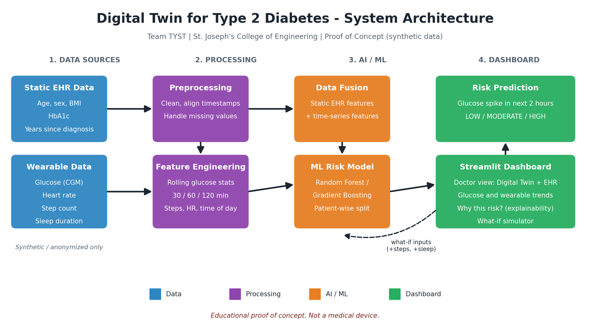

# 🩺 Digital Twin for Type 2 Diabetes

> A Digital Twin that combines EHR data with wearable data to predict the risk of a glucose spike up to **2 hours in advance**, moving diabetes care from reactive to proactive.

**Digital Twin Challenge 2026 | Prototype & Code Submission**

| | |
|---|---|
| 🎥 **Demo Video (Unlisted YouTube)** | **[PASTE YOUTUBE LINK HERE]** |
| 🏗️ **Architecture Diagram (PDF)** | [docs/architecture_diagram.pdf](docs/architecture_diagram.pdf) |
| 📊 **Presentation (PDF)** | [docs/presentation.pdf](docs/presentation.pdf) |
| 🌐  **Dashboard Link** | https://digital-twin-diabetes-prediction-1-n2tns7guylgumnfvoenvdu.streamlit.app/ |
| 📜 **License** | [MIT](LICENSE) |
---


## 👥 Team Details

**Team Name:** TYST

| Role | Name |
|---|---|
| Team Leader | SUDHAKAR T K |
| Member 2 | THARUN BALAJI |
| Member 3 | Thilakan S |
| Member 4 | Yogavel D |

## 🏫 College / Incubator Information

- **College:** St. Joseph's College of Engineering
- **Incubator:** Not applicable

## 📌 Project Title

**Digital Twin for Type 2 Diabetes: Predicting Glucose-Spike Risk 2 Hours Ahead**

---

## ❗ Problem Statement

Patients with Type 2 Diabetes experience glucose fluctuations influenced by physical activity, sleep, heart rate, lifestyle patterns and earlier glucose readings.

Traditional monitoring mostly flags abnormal glucose **after** it has happened. Clinicians and patients get little warning, so action is reactive rather than preventive.

**Our goal:** continuously analyse a patient's historical and time-series data to estimate the risk of an upcoming glucose spike **before it occurs**.

---

## 🏥 Healthcare Use Case

**Primary users:** doctors and diabetes care teams reviewing a patient's Digital Twin.

**How it is used in practice**
1. The doctor opens a patient's Digital Twin on the dashboard.
2. The twin shows recent glucose, heart rate, steps and sleep alongside the patient's EHR profile (age, BMI, HbA1c, years since diagnosis).
3. The system shows a **Low / Moderate / High** risk of a glucose spike in the next 2 hours.
4. The dashboard explains **which factors** drive the risk.
5. A **what-if simulator** shows how changes such as more walking or more sleep would change the risk, supporting a conversation about personalised lifestyle advice.

**Who benefits**
- **Doctors:** earlier warning and an explanation, not just a number.
- **Patients:** proactive, personalised guidance instead of after-the-fact alerts.
- **Healthcare systems:** a path toward fewer avoidable glucose-related emergencies.

> The tool supports clinical decision-making. It does not replace the clinician.

---

## 💡 Proposed Solution

The Digital Twin fuses two data streams.

**1. Static / historical EHR data:** age, sex, BMI, HbA1c, years since diagnosis.

**2. Dynamic / wearable data:** continuous glucose, heart rate, step count, sleep duration.

These are preprocessed, turned into features and fused before being passed to a machine-learning model that outputs:

> **Low / Moderate / High risk of a glucose spike within the next 2 hours**

### Workflow

```
Patient Data
   ↓
EHR Data + Wearable/Sensor Data
   ↓
Data Preprocessing
   ↓
Feature Engineering & Data Fusion
   ↓
AI/ML Prediction Model
   ↓
Glucose Spike Risk Prediction
   ↓
Digital Twin Dashboard
```

## 🏗️ Architecture Diagram



📄 PDF version: [docs/architecture_diagram.pdf](docs/architecture_diagram.pdf)

---

## 🛠️ Technical Stack

| Area | Tools |
|---|---|
| Language | Python 3 |
| Data | Pandas, NumPy |
| Machine learning | Scikit-learn |
| Explainability | SHAP / feature importance |
| Dashboard | Streamlit |
| Visualisation | Plotly, Matplotlib |
| Development | Jupyter Notebook, Git & GitHub |

---

## 🤖 AI/ML Model or Framework Details

### Prediction task
Binary classification: will glucose exceed **180 mg/dL** at any time in the next **2 hours**? The probability is mapped to Low / Moderate / High.

### Data
Synthetic patients generated by [`src/generate_data.py`](src/generate_data.py): 50 patients × 14 days at 5-minute intervals (about 200,000 rows). The simulator models post-meal glucose rises, the effect of walking after meals, the effect of poor sleep, and higher glucose with higher HbA1c. See [`data/README.md`](data/README.md).

| Column | Description |
|---|---|
| `patient_id`, `timestamp` | Patient and 5-minute timestamp |
| `glucose` | Glucose (mg/dL) |
| `heart_rate` | Beats per minute |
| `steps` | Steps in the 5-minute window |
| `sleep_hours` | Previous night's sleep |
| `age`, `sex`, `bmi`, `hba1c`, `years_since_diagnosis` | Static EHR features |
| `spike_2h` | Label: 1 if glucose > 180 mg/dL within the next 2 hours |

### Feature engineering and data fusion
- Rolling glucose mean, std, min, max and trend over 30 / 60 / 120 minutes
- Steps over the last 30 / 60 / 120 minutes, and heart-rate averages
- Sleep hours and time of day (sin/cos)
- Static EHR features concatenated with the time-series features (**data fusion**)
- Features use **past data only**, to avoid leakage

### Models
- Baseline rule (glucose threshold)
- Logistic Regression
- Random Forest / Gradient Boosting (main model)

### Validation
- Train/validation/test split **by patient**, so no patient appears in more than one set
- Metrics: ROC-AUC, PR-AUC, recall, precision, F1, confusion matrix (accuracy alone is misleading with imbalanced classes)
- Probabilities are calibrated and mapped to Low / Moderate / High using thresholds chosen on the validation set

### Results
<!-- TODO (Tharun): replace with real numbers from docs/metrics.json -->

| Model | ROC-AUC | Recall | Precision | F1 |
|---|---|---|---|---|
| Baseline rule | TBD | TBD | TBD | TBD |
| Logistic Regression | TBD | TBD | TBD | TBD |
| Random Forest / Gradient Boosting | TBD | TBD | TBD | TBD |

> Results are on **synthetic data**. They show that the pipeline works end to end. They are not evidence of clinical performance, which would need real-world validation.

### Explainability
Feature importance / SHAP shows the top factors behind each prediction, displayed on the dashboard as "Why this risk?".

---

## 🖥️ Doctor Dashboard

- Patient selector and EHR profile card
- Glucose trend with the 180 mg/dL threshold line
- Heart rate, steps and sleep
- Risk gauge: Low / Moderate / High for the next 2 hours
- "Why this risk?" explanation panel
- What-if simulator (extra steps, extra sleep)

<!-- TODO (Yogavel): add screenshots from docs/screenshots/ -->
<!--  -->

---

## 🎥 Demo Video

**[PASTE UNLISTED YOUTUBE LINK HERE]**

Covers the problem, data, model, dashboard walkthrough, results and future work.

## 📊 Presentation

[docs/presentation.pdf](docs/presentation.pdf): project details and outcomes.

---

## 🚀 How to Run

```bash
git clone https://github.com/SUDHAKAR1104/digital-twin-diabetes-prediction.git
cd digital-twin-diabetes-prediction
python -m venv .venv
.venv\Scripts\activate          # Windows (Linux/Mac: source .venv/bin/activate)
pip install -r requirements.txt

python src/generate_data.py     # creates data/synthetic_patients.csv
python src/train.py             # trains and saves models/risk_model.pkl
streamlit run dashboard/app.py  # launches the dashboard
```

## 📂 Repository Structure

```
digital-twin-diabetes-prediction/
├── data/            synthetic dataset and data dictionary
├── notebooks/       exploration and experiments
├── src/             data generation, features, training, prediction
├── models/          saved model
├── dashboard/       Streamlit app
├── docs/            architecture diagram, presentation, screenshots
├── requirements.txt
├── LICENSE
└── README.md
```

---

## 🔒 Data Privacy

Only synthetic, anonymized or permitted open-source data is used. No personally identifiable patient information is included.

## ⚠️ Medical Disclaimer

This project is an educational and research Proof-of-Concept. It is **not a medical device** and must not be used for clinical diagnosis, treatment or medical decision-making.

## ⚖️ Limitations

- Trained and evaluated on synthetic data only
- Real patients vary more than the simulator
- No clinical validation or regulatory review

## 🔭 Future Work

- Validate on real, consented, de-identified CGM and EHR data
- Add medication and meal logging to the twin
- Per-patient personalisation
- Clinical validation with healthcare professionals


## 🚀 Live Dashboard

Try the Diabetes Digital Twin Risk Prediction Dashboard here:

[**Open Live Dashboard**](https://digital-twin-diabetes-prediction-1-n2tns7guylgumnfvoenvdu.streamlit.app/)

### Features
- Diabetes risk prediction
- Risk probability visualization
- Key risk factors explanation
- What-if analysis


## 📜 Open-Source License

Released under the **MIT License**. See [LICENSE](LICENSE).

## ✅ Public Accessibility

All files, the demo video (unlisted YouTube) and documents linked here are publicly accessible without additional permissions.


